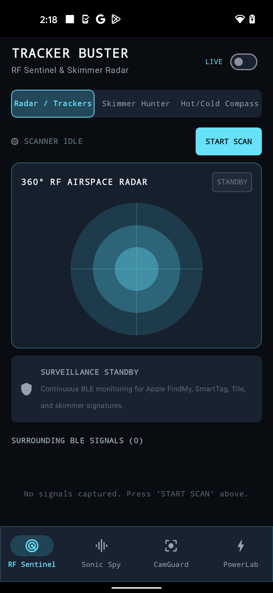
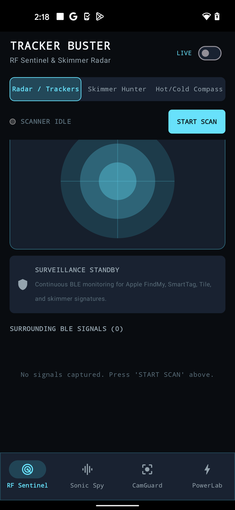
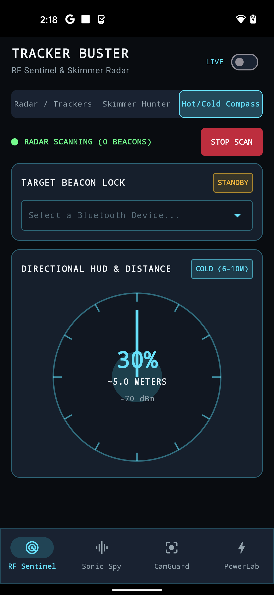
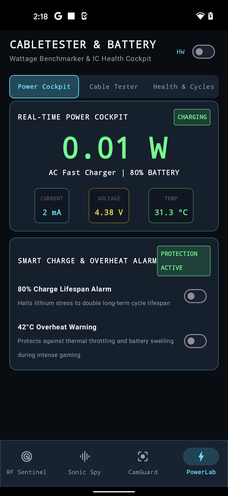
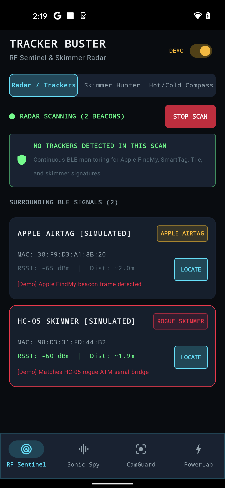
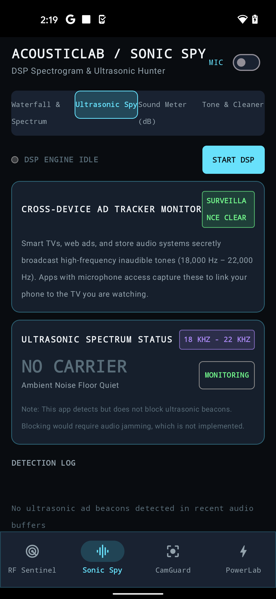
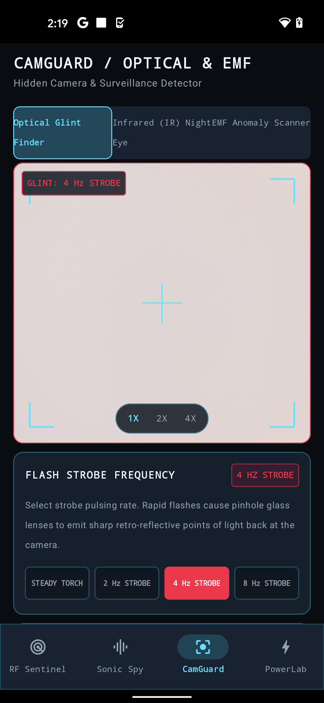
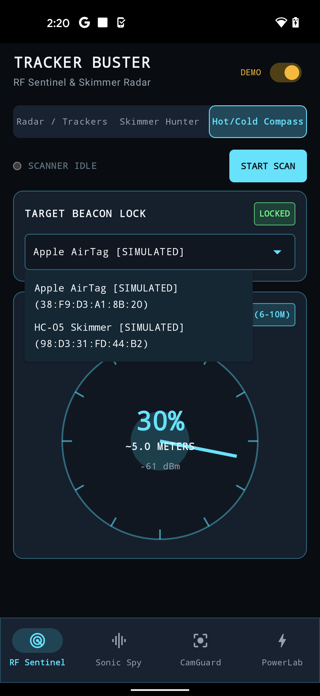

# TrackerBuster — Counter-Surveillance & Electronic Bug Detector for Android

<div align="center">

-3DDC84?style=for-the-badge&logo=android&logoColor=white)


[](https://wa.me/923171616345?text=Hi%20letmese%2C%20I%20am%20interested%20in%20your%20TrackerBuster%20Android%20app.)

### *All-in-One TSCM Privacy Suite: Bluetooth LE AirTag Scanner, Optical Camera Glint Finder, and Acoustic Bug Spectrogram*

</div>

---

## 📖 Overview

**TrackerBuster** is an on-device electronic counter-surveillance (TSCM) and privacy protection suite built for Android. It equips users to detect unwanted physical tracking devices, covert surveillance bugs, and hidden pinhole cameras in hotel rooms, rented vehicles, Airbnbs, and meeting spaces.

---

## 📱 App Preview (Live Firebase Test Lab Pixel 5 Screenshots)

<div align="center">
  
  
  
  
</div>

<div align="center">
  
  
  
  
</div>

---

### 📡 1. RF Sentinel (Bluetooth LE & Tracker Hunter)
- Detects nearby unwanted BLE beacons including **Apple AirTags**, **Samsung SmartTags**, **Tile trackers**, and generic Bluetooth beacons.
- Measures continuous RSSI signal strength to triangulate the physical distance to the tracking tag.
- Alerts when an unknown tracker appears to be following your location.

### 📷 2. CamGuard (Optical Pinhole Camera Glint Finder)
- Uses high-frequency strobe illumination coupled with specialized camera exposure algorithms to detect lens reflections (retro-reflections) from hidden pinhole cameras.
- Highlights circular optical reflections typically produced by camera sensor focal planes.

### 🎙️ 3. Sonic Spy (Acoustic Spectrogram)
- Real-time high-frequency FFT audio analysis to detect ultrasonic beacons, covert audio bugs, and acoustic surveillance transmitters operating outside human hearing ranges.

### 🧭 4. MagScan (Magnetic Field Anomaly Detector)
- Interfaces with the device magnetometer to locate magnetic GPS trackers attached beneath vehicle chassis or hidden behind metallic trim.

---

## 🛠️ Architecture & Tech Stack

- **Platform:** Android (compileSdk / targetSdk 34)
- **Language:** Kotlin
- **Hardware Integration:** Android Bluetooth LE APIs (`BluetoothLeScanner`), Camera2 API, AudioRecord FFT pipeline, SensorManager.
- **Privacy Policy:** 100% on-device execution. Zero audio, camera frames, or sensor logs are uploaded to any remote server.

---

## 🚀 Building from Source

### Prerequisites
* Android Studio (2024+)
* Android SDK 34
* JDK 17

### Build Instructions
```bash
git clone https://github.com/letmese/TrackerBuster.git
cd TrackerBuster

# Build debug APK
./gradlew assembleDebug
```

---

## 📦 Pre-Built Downloads

To download the ready-to-run APK (`TrackerBuster.apk`), check the releases:
* **[GitHub Releases](https://github.com/letmese/TrackerBuster/releases)**

---

## 👨‍💻 Developer & Inquiries

Designed and developed by **letmese**.

* **GitHub Profile:** [@letmese](https://github.com/letmese)
* **Location:** Lahore, Pakistan (Available for projects & consulting worldwide)
* **WhatsApp Direct:** [**+92 317 1616345**](https://wa.me/923171616345?text=Hi%20letmese%2C%20I%20am%20interested%20in%20your%20TrackerBuster%20Android%20app.)

---

## 📄 License

This project is licensed under the [MIT License](LICENSE).
